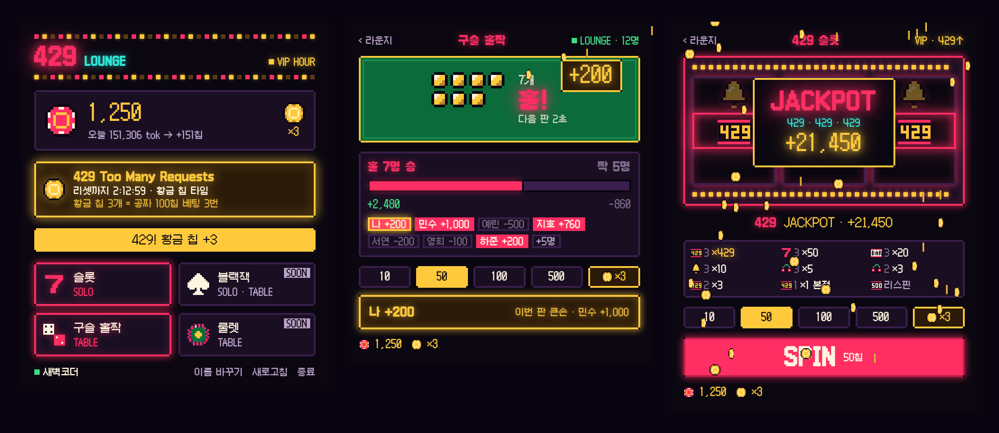

# 429 Lounge

> HTTP 429 Rate Limit. 한도에 걸린 개발자들이 찾아오는 VIP 카지노 라운지.

토큰 사용량을 칩으로 바꿔 회원들과 짧은 카지노 게임을 즐기는 macOS 메뉴바 앱.



- 빌드나 Claude 답변을 기다리는 **10~30초짜리 틈**에 한 판
- 코딩하는 만큼 메뉴바의 칩이 오른다
- 리밋(429)에 걸리면 **VIP HOUR**. 리셋 전까지 쓸 수 있는 황금 칩을 준다

> 프로토타입 단계.

## 설치

**Claude Code/Codex에 붙여 넣기(추천):**

```
https://raw.githubusercontent.com/Jiwook00/429-lounge/main/docs/install.md 읽고 그대로 429 Lounge 설치해줘
```

또는 직접 설치 - macOS 14 이상. 터미널에 한 줄:

```sh
curl -fsSL https://raw.githubusercontent.com/Jiwook00/429-lounge/main/scripts/install.sh | bash
```

최신 [릴리스](https://github.com/Jiwook00/429-lounge/releases/latest)를 받아 `/Applications`에 넣고 실행한다. 앱에 새 버전이 표시되면 업데이트 카드에서 설치할 수 있다. 설치 명령으로도 업데이트할 수 있다.

- 메뉴바에 슬롯머신 아이콘과 칩 수가 뜬다. Bartender나 Ice 같은 메뉴바 관리 앱을 쓰면 숨김 영역에 들어갔을 수 있다
- 처음 들어오면 "손님 3F2A9C" 같은 임시 이름이 붙고, 닉네임을 정해야 테이블에 앉을 수 있다. 바꾸려면 팝오버 아래 "이름 바꾸기"
- 칩은 `~/.claude/projects`(Claude Code)와 `~/.codex/sessions`(Codex) 로그에서 토큰 사용량만 읽어서 계산한다. 둘 다 쓰면 합산한다. 대화 내용은 서버로 보내지 않는다
- 앱이 켜져 있는 동안 다른 회원에게 보이는 건 닉네임, 팝오버를 보고 있는지, 어느 게임 화면인지, 그리고 "코딩 중 / 429 VIP / 쉬는 중" 같은 대략적인 상태뿐이다. 프로젝트 이름이나 토큰 양은 공유하지 않는다
- 지우기: `rm -rf "/Applications/429 Lounge.app" ~/Library/Application\ Support/429Lounge`

릴리스 zip을 직접 받았다면 ad-hoc 서명이라 Gatekeeper가 막는다. `xattr -dr com.apple.quarantine "/Applications/429 Lounge.app"` 후 실행.

## 기능

### 지금 라운지

앱만 켜 두면 라운지에 들어와 있는 것. 팝오버를 열면 누가 같이 있는지 보인다.

- **라운지 3/12명**: 앱이 켜져 있는 회원 / 닉네임을 정한 전체 회원. **보는 중**인 회원은 시안 네온으로 빛난다
- 지금 없는 회원은 `이름 · 3시간 전`처럼 마지막으로 본 시각과 함께 흐리게
- 회원마다 **코딩 중 / 429 VIP / 쉬는 중**: 각자의 Claude Code·Codex 로그에서 계산한 대략적인 상태
- 사람이 앉아 있는 테이블은 `TABLE · 2명 앉음`으로 빛나고, 메뉴바 슬롯머신의 레버 공이 시안으로 켜진다
- 띠 첫 줄의 `랭킹 ▸`을 누르면 카드가 뒤집혀 **이번 주 큰손**: 이번 주(월요일 00시부터) 게임에서 딴 칩 − 건 칩 순위. 토큰 환전·오늘의 칩은 안 센다. 10위까지 스크롤로 보고, 칩 화면에 지난주 내 순위가 뜬다
- 누가 **잭팟**이나 큰 승리를 터뜨리면 로고 아래 **전광판**이 3분 동안 나타나 흐른다
- 다른 회원이 **잭팟**을 터뜨리면 메뉴바 슬롯머신이 5초 동안 깜빡인다. `설정 → 다른 회원의 잭팟 알림`을 켜면 macOS 알림도 온다

게임 소리는 기본 무음이다. 로비의 `설정 → 게임 소리`에서 켜고, 게임 중에는 스피커 버튼으로 끈다. `음악·주변음`을 끄면 행동 효과음만 들린다. 곡과 음악 음량은 설정에서 바꿀 수 있다.

### 칩

| 수입      |                                                                           |
| --------- | ------------------------------------------------------------------------- |
| 토큰 환전 | 새로 쓴 토큰 1,000개 = 1칩 (캐시 읽기 제외, 상한 없음)                    |
| 오늘의 칩 | 잔액 옆 버튼으로 하루(KST) 한 번 받는다. +100칩, 누를 때 잔액 100 미만이면 +300칩 |
| 황금 칩   | 429에 걸리면 3개(주간 리밋 10개). 1개 = 공짜 100칩 베팅. 리셋 시각에 소멸 |

칩은 현금·실물로 바꿀 수 없고 주고받을 수도 없다. 자세한 규칙은 [docs/chip-economy.md](docs/chip-economy.md).

### 미니 룰렛

0~12, 13칸짜리 룰렛. 누군가 칩을 놓으면 12초 동안 회원들이 같은 판에 건다. 칸을 누르면 바로 걸리고, 숫자 하나는 12배, 빨강·검정 / 홀·짝 / 1–6·7–12는 2배. 공이 6초 동안 칸을 건너뛰다 멈추고, **0이 나오면 무효 판**이라 건 칩을 모두 돌려받는다. 결과와 정산은 전부 서버에서.

### 소수결

평일 8시, 11시, 14시에 질문이 올라온다 ("탭 vs 스페이스"). 둘 중 하나에 50칩을 걸고, 3시간 뒤 **적게 고른 쪽**이 진 사람 칩을 나눠 갖는다. 3명이 안 모이거나 동점, 전원 일치면 무효. 결과가 나오면 누가 뭘 골랐는지 공개된다.

### 블랙잭

만화 5컷 테이블: 위 컷에 딜러, 아래 4컷이 자리. 10초 동안 걸고, 빈 자리는 AI가 채운다. 1번 자리부터 차례대로 히트 / 스탠드 / 더블다운(사람은 11초, 넘기면 스탠드). 블랙잭은 3:2. 내 차례엔 내 컷이 커지고, 카드는 컷 사이로 사라졌다 나타나며 날아온다.

### 429 슬롯

SPIN은 요청, 결과는 HTTP 응답.

- 일반 칩은 10·50·100·200칩을 걸 수 있고, 기본값은 50칩이다
- **500** 이 뜨면 그 릴이 치지직 깨지고 다시 돈다
- **429 세 개 = ×429 잭팟**. 실제로 리밋에 걸린 VIP HOUR엔 429가 더 자주 나온다
- 결과는 `200 OK`, `304 Not Modified`, `404 Not Found`처럼 응답 코드로 표시

## 개발 환경

필요한 것: macOS 14+, Xcode(Swift 6), Docker, [Supabase CLI](https://supabase.com/docs/guides/cli)

```sh
supabase start                  # 로컬 백엔드 (첫 실행은 이미지 다운로드로 몇 분)
scripts/build-app.sh --open     # build/429 Lounge.app 빌드 후 실행
```

이렇게 만든 앱은 로컬 서버에 붙는다. 혼자 멀티를 해보려면 상대 봇을 앉힌다:

```sh
swift run lounge-bot --name 철수
```

## 릴리스

첫 Sparkle 배포 전에 서명 키를 한 번 만든다. Swift 빌드가 받은 Sparkle 도구를 쓴다.

```sh
swift build --product Lounge429
.build/artifacts/sparkle/Sparkle/bin/generate_keys --account co.dwook.lounge429
```

비공개 키는 로그인 키체인에 보관된다. 복구용 사본은 안전한 곳에 보관하고 매 릴리스에 같은 키를 사용한다. 아래 환경 변수에는 첫 배포 때 앱에 넣은 **공개키**를 지정한다. 빌드는 그 키가 키체인의 서명 키와 일치하는지 확인한다.

```sh
# 서버 변경이 있으면 supabase db push --dry-run 후 확인받아 적용
# scripts/build-app.sh의 VERSION을 올리고 커밋·푸시한 뒤
export LOUNGE_SPARKLE_PUBLIC_KEY='<처음 등록한 공개키>'
scripts/build-app.sh --dist     # 유니버설 앱, 서명된 appcast와 배포 ZIP
TAG=vX.Y.Z                     # VERSION과 같은 Git 태그
gh release create "$TAG" build/429-Lounge.zip build/appcast.xml --draft --verify-tag --title "$TAG" --notes "..."
# 초안에서 ZIP과 appcast를 함께 확인한 뒤 공개한다.
```

앱은 GitHub의 최신 정식 릴리스에서 `appcast.xml`을 읽는다. 최신으로 공개하는 모든 릴리스에 두 파일을 함께 올린다. 버전마다 다른 ZIP URL을 사용하므로 이전 피드를 읽은 앱도 피드에 서명된 ZIP을 받을 수 있다. Sparkle이 들어가기 전 앱에서는 설치 명령으로 한 번 업데이트한다.

새 버전은 OPEN 위에 `vX.Y.Z 나옴`으로 표시한다 (30분마다 확인). RPC를 깨는 마이그레이션에서는 서버 최소 버전도 올린다. `--remote`는 ZIP 없이 운영 서버용 앱을 만들고 로컬 빌드처럼 Sparkle 피드를 설정하지 않는다. [ADR-0007](docs/madr/0007-remote-supabase-zip-distribution.md), [ADR-0016](docs/madr/0016-sparkle-updates.md).

## 개발

```sh
swift build && swift test
swift run lounge-scan                                  # 토큰 로그 파싱 결과
.build/debug/Lounge429 --snapshot out.png [--locked] [--table readme|roulette-idle|roulette-betting|roulette-golden|roulette-alone|roulette-spin|roulette-cut-near|roulette-cut-edge|roulette-cut-land|roulette-closed|roulette-win|roulette-void|roulette-help|roulette-live|slot-idle|slot-spinning|slot-glitch|slot-win|slot-big|slot-jackpot|slot-lose|slot-live|nickname|nickname-taken|lobby-busy|lobby-quiet|lobby-ticker|lobby-alone|lobby-board|lobby-board-me|lobby-board-empty|lobby-flip|lobby-live|minority-open|minority-picked|minority-closed|minority-result-win|minority-result-lose|minority-result-void|update|update-required]
supabase db reset                                      # 마이그레이션 전체 재적용 (데이터 삭제)
```

| 환경변수 | |
| -------------------------------------------- | ---------------------------------------- | ----------------------------------- |
| `LOUNGE_FAKE_429=1` | 가짜 429 상태로 실행 (VIP HOUR, 황금 칩) |
| `LOUNGE_DEBUG=1` | Realtime 이벤트 로그 |
| `LOUNGE_E2E_BET=golden\|chips` | `--table roulette-live` 스냅샷에서 자동 베팅 |
| `LOUNGE_SERVER=remote` | 운영 서버(`LoungeConfig.remote`) 사용 |
| `LOUNGE_SUPABASE_URL`, `LOUNGE_SUPABASE_KEY` | 임의의 Supabase 사용 (가장 우선) |

## 구조

```
Sources/
  LoungeCore/     Claude Code·Codex 로그 파싱 (사용량, 429)
  LoungeNet/      Supabase: 익명 로그인, RPC, Realtime
  Lounge429/      메뉴바 앱 (SwiftUI)
    UI/           테마, 도트 렌더러, 스프라이트, 화면
  lounge-bot/     개발용 봇
  lounge-scan/    개발용 로그 확인 CLI
supabase/
  migrations/     스키마 + 게임·칩 로직 (Postgres 함수)
scripts/          .app 번들 / 배포 zip 빌드, 설치 스크립트
docs/
  chip-economy.md 칩 규칙
  madr/           아키텍처 결정 기록 (ADR)
DESIGN.md         디자인 기준 (임시, 계속 업데이트)
CLAUDE.md         Claude Code 작업 가이드
```

## 문서

- [DESIGN.md](DESIGN.md): 컨셉, 픽셀 규칙, 타이포, 색, 열린 디자인 결정
- [docs/chip-economy.md](docs/chip-economy.md): 칩 수입과 서버 검사
- [docs/madr/](docs/madr/): 왜 이렇게 만들었는지 (Swift Package, Supabase, 서버 정산, 토큰 환율, 도트, 인증, 순위표)

## 로드맵

1. 스프라이트 시트 정식 제작, 황금 칩 획득 연출
2. 상태 공유 끄기 설정
3. 방 코드로 테이블 나누기
4. 공개 배포 (Developer ID 서명, 공증, 자동 업데이트)

## 크레딧

- 폰트: [Galmuri](https://github.com/quiple/galmuri) by Minseo Lee, SIL Open Font License 1.1
